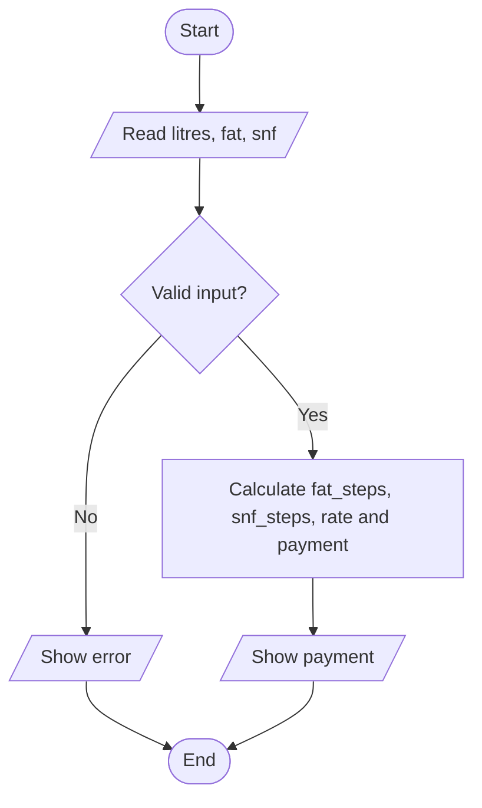

# Task 8 - Plan the Algorithm

Stages: 1 Understand the problem, 2 Plan (pseudocode, flowchart), 3 Write the code, 4 Test it.

## Pseudocode - one payment
    BEGIN
      READ litres, fat, snf
      IF litres < 0 OR fat < 2.0 OR fat > 7.0 THEN
        DISPLAY "invalid"
      ELSE
        fat_steps = ROUND((fat - 3.5) / 0.1)
        snf_steps = ROUND((snf - 8.5) / 0.1)
        rate = 30.00 + fat_steps * 0.40 + snf_steps * 0.30
        payment = ROUND(litres * rate, 2)
        DISPLAY payment
      ENDIF
    END

## Pseudocode - ten-day total
    BEGIN
      total = 0
      FOR each entry of the farmer
        IF entry is valid THEN total = total + payment
      ENDFOR
      DISPLAY total
    END

## Flowchart (one entry)

## Hand-trace
| Entry | litres | fat | snf | fat_steps | snf_steps | rate | payment |
|---|---|---|---|---|---|---|---|
| 1 | 10 | 3.5 | 8.5 | 0 | 0 | 30.00 | 300.00 |
| 2 | 8.5 | 4.2 | 8.7 | 7 | 2 | 33.40 | 283.90 |
| 3 | 12 | 3.1 | 8.3 | -4 | -2 | 27.80 | 333.60 |

Total = 917.50 (Task06/functions.py prints the same ten-day total).

## List vs running total
A list takes O(n) time and O(n) space. A running total takes O(n) time and O(1) space.
Keep the list only when the individual entries are needed later.
